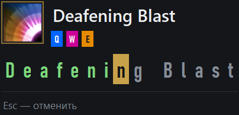

# Invoker Overlay

Показывает название заклинания Инвокера, пока ты его набираешь.

## Запуск

Скачай папку, распакуй куда угодно и запусти один раз:
install-gsi.bat      ← после этого перезапусти Dota 2

Далее только start.bat

## Как играть

1. Набери орбы — **Q**, **W**, **E**.
2. Нажми **R** (Invoke).
3. Напиши название заклинания **целиком**, начиная с первой буквы:

       Cold Snap        →  coldsnap
       E.M.P.           →  emp
       Deafening Blast  →  deafeningblast
4. Буквы отмечаются по мере ввода: видно, что уже набрано и сколько осталось.

Esc — отменить. Backspace — стереть букву.

## Клавиши

| Клавиша | Что делает |
|---|---|
| Q, W, E | орбы: Quas, Wex, Exort |
| R | Invoke — вызвать заклинание |
| Esc | отменить ввод |
| Backspace | стереть букву |
| Ctrl+Alt+Q | закрыть приложение |
| Ctrl+Alt+R | сбросить очередь орбов |

Переназначить можно всё:

    rebind.bat

## Что приложение не умеет

Приложение **зеркалит нажатия, а не читает игру**. Оно знает, какие клавиши ты нажал, но не
знает, что игра с ними сделала: Dota отдаёт наружу только имя героя и жив ли он — ни
очереди орбов, ни уровней способностей, ни маны, ни наложенных эффектов.

Поэтому есть случаи, когда наша картина расходится с игрой. Угадать их нельзя — данных для
этого просто нет.

**Орб не прокачан.** Нажал Q, а Quas ещё не выучен: игра орб не добавила, а мы посчитали.

**Invoke не сработал.** В кд, действует сайленс, хекс или стан — игра
`R` проигнорирует, а мы откроем подсказку и будем ждать ввод.

**Умер перед самым нажатием.** Про смерть мы узнаём от игры с задержкой. Нажатия в этот
промежуток запоминаются, хотя игра их уже не применяет.

**Запустил посреди матча.** Заклинания в слотах D и F мы не читаем — помним только те, что
вызвали сами. Если приложение запущено не с начала матча, про слоты оно ничего не знает.

**Игра не приняла наши нажатия.** Закончив ввод, приложение досылает в игру орбы и Invoke.
Проверить, что игра их приняла, невозможно — остаётся верить, что всё прошло.

Если заметил расхождение — **Ctrl+Alt+R** и набери комбинацию заново. После сброса слоты
D и F тоже забываются: при следующем Invoke подсказка появится, даже если заклинание уже
собрано. Дальше всё как обычно.

